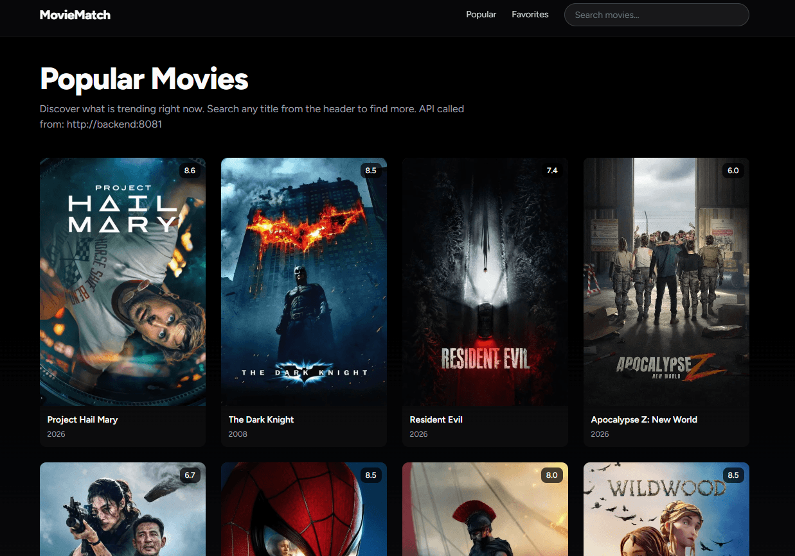
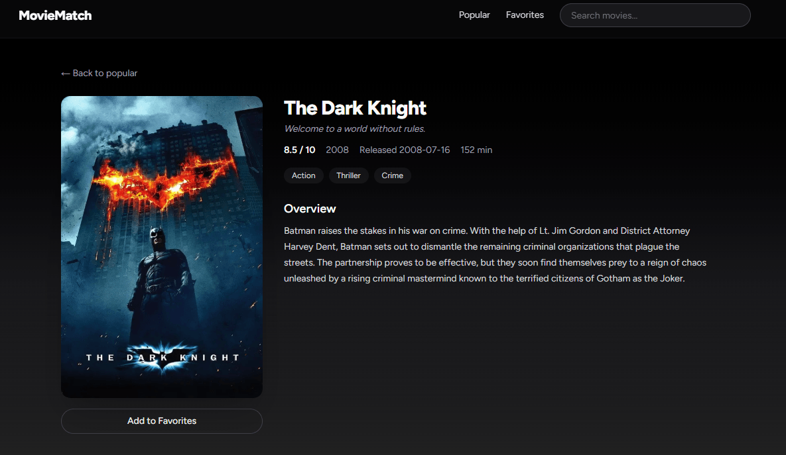
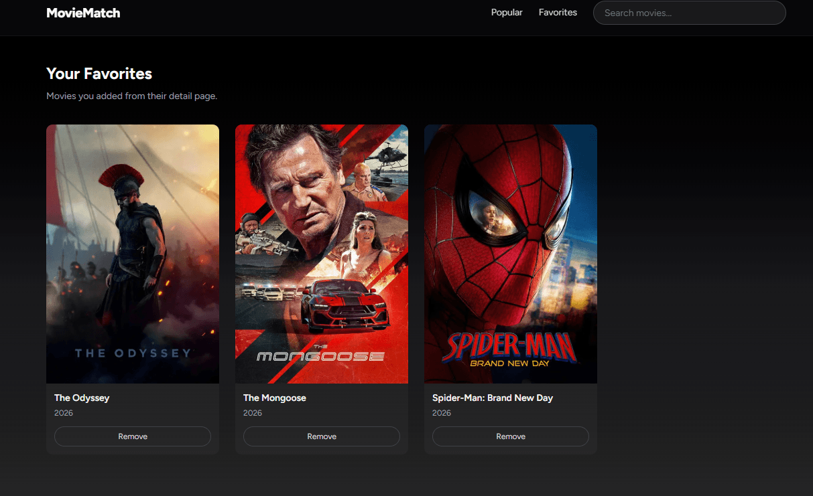

# Movie Match

A cloud-native movie discovery platform built with **Flask**, **Next.js**, and **Google Cloud Platform (GCP)**. This project is a hands-on learning exercise for exploring cloud infrastructure, managed services, event-driven data flows, containerization, and CI/CD through a practical application.


## Table of contents

- [Overview](#overview)
- [Application screenshots](#application-screenshots)
- [Architecture](#architecture)
- [Technology stack](#technology-stack)
- [Local development](#local-development)
- [Google Cloud deployment](#google-cloud-platform-deployment)
- [CI/CD with GitHub Actions](#cicd-with-github-actions)
- [Project structure](#project-structure)
- [API endpoints](#api-endpoints)

## Overview

Movie Match lets users discover movies, inspect movie details, and maintain a list of favourite movies. Movie information is retrieved from [The Movie Database (TMDB)](https://www.themoviedb.org/).

Alongside the application itself, the project explores how to run a containerized frontend and backend on GCP and how to collect application events for analytics.

## Application screenshots

### 1. Movie discovery — home page



The home page displays a collection of movies users can browse and discover.

### 2. Movie details



The details page presents information and metadata for a selected movie.

### 3. Favourite movies



The favourites page lists movies saved by the user.


## Architecture

The application is split into a Next.js frontend and a Flask backend. The backend uses PostgreSQL for persistent application data, Redis for caching, TMDB as an external movie-data API, and Pub/Sub to publish user events. A BigQuery subscription stores event messages for analytics.


## Technology stack

### Backend
- **Framework**: Flask (Python 3.13)
- **Database**: PostgreSQL 17
- **Cache**: Redis
- **Event Streaming**: Google Cloud Pub/Sub
- **Analytics**: BigQuery
- **External API**: TMDB (The Movie Database)

### Frontend
- **Framework**: Next.js 16 (React 19)
- **Styling**: Tailwind CSS 4
- **UI Components**: Radix UI, shadcn

### Infrastructure
- **Container Registry**: Google Artifact Registry
- **Compute**: Cloud Run (serverless containers)
- **Database**: Cloud SQL (PostgreSQL)
- **Cache**: Cloud Memorystore (Redis)
- **Networking**: VPC with custom subnet
- **CI/CD**: GitHub Actions


### Event analytics flow

The backend publishes events to a Pub/Sub topic. A BigQuery subscription writes messages and Pub/Sub metadata to a BigQuery table, where the data can be queried for application analytics.


## Local Development

### Prerequisites
- Docker and Docker Compose
- Python 3.13+
- Node.js 24+
- TMDB API Key

### Clone the repository

```bash
git clone https://github.com/AbderrahmaneOd/gcp-movie-discovery-platform.git
cd gcp-movie-discovery-platform
```

### Environment Setup

1. **Backend environment variables** (`backend/.env`):
```env
DATABASE_URL=postgresql+psycopg://<db_user>:<db_password>@localhost:5432/<database_name>
REDIS_HOST=localhost
REDIS_PORT=6379
TMDB_API_KEY=<your_tmdb_api_key>
SECRET_KEY=dev-secret
GCP_PROJECT_ID=my-local-project
TOPIC_ID=events
PUBSUB_EMULATOR_HOST=localhost:8085
```

2. **Frontend environment variables** (`frontend/.env.local`):
```env
NEXT_PUBLIC_API_URL=http://localhost:5000
SERVER_API_URL=http://localhost:5000
```

### Run with Docker Compose

```bash
docker-compose -f docker-compose.dev.yaml up
```

**Services:**
- Frontend: http://localhost:3000
- Backend: http://localhost:5000
- PostgreSQL: localhost:5432
- Redis: localhost:6379
- Pub/Sub Emulator: localhost:8085

###  Run locally without Docker

**Backend:**

```bash
cd backend

python -m venv .venv

# Linux/macOS
source .venv/bin/activate

# Windows PowerShell
# .venv\Scripts\Activate.ps1

pip install -r requirements.txt
python run.py
```

**Frontend:**

Open another terminal:

```bash
cd frontend
npm install
npm run dev
```

### Database Setup

Connect to your local PostgreSQL instance using the credentials configured in `backend/.env`:

```bash
psql -U <db_user> -d <database_name> -W
```

The favourites table used by the application has the following schema. Apply it only if your local database has not already been initialized by the application's database setup or migrations.

```sql
CREATE TABLE favorites (
    id INTEGER GENERATED BY DEFAULT AS IDENTITY PRIMARY KEY,
    session_id VARCHAR(128) NOT NULL,
    movie_id INTEGER NOT NULL,
    title VARCHAR(500) NOT NULL,
    poster_path VARCHAR(500),
    release_date VARCHAR(50),
    vote_average DOUBLE PRECISION,
    year INTEGER,
    created_at TIMESTAMP WITH TIME ZONE NOT NULL DEFAULT NOW(),
    CONSTRAINT uq_favorites_session_movie UNIQUE (session_id, movie_id)
);

CREATE INDEX ix_favorites_session_id ON favorites (session_id);
```

### Test Pub/Sub Emulator

Create topic and subscription:

```bash
curl -X PUT "http://localhost:8085/v1/projects/my-local-project/topics/events"

curl -X PUT "http://localhost:8085/v1/projects/my-local-project/subscriptions/events-sub" \
  -H "Content-Type: application/json" \
  -d '{"topic": "projects/my-local-project/topics/events"}'
```

Publish a test message. First, encode the message as Base64:

```bash
echo -n '{"event_type":"movie_favourites","session_id":"123","movie_id":456}' | base64
```

Copy the resulting Base64 string and use it in the publish request:

```bash
curl -X POST "http://localhost:8085/v1/projects/my-local-project/topics/events:publish" \
  -H "Content-Type: application/json" \
  -d '{"messages": [{"data": "BASE64_OUTPUT_HERE"}]}'
```

Pull messages from the subscription:
```bash
curl -X POST "http://localhost:8085/v1/projects/my-local-project/subscriptions/events-sub:pull" \
  -H "Content-Type: application/json" \
  -d '{"maxMessages": 10, "returnImmediately": true}'
```

Decode base64 payload:
```bash
echo "<BASE64_VALUE>" | base64 --decode
```

## Google Cloud Platform Deployment

### Prerequisites

- A Google Cloud project with billing enabled.
- The Google Cloud CLI (`gcloud`) installed and authenticated.
- Required permissions to enable APIs and create the resources described below.
- A configured GitHub repository for the CI/CD workflow.


Authenticate and select your project:

```bash
gcloud auth login
gcloud config set project <your-project-id>
gcloud config get-value project
```

### Environment Variables

Set these variables for your deployment:

```bash
export PROJECT_ID="<your-project-id>"
export REGION="europe-west9"
export REPOSITORY="movie-app"
export SQL_INSTANCE="movie-postgres"
export REDIS_INSTANCE="movie-redis"
export VPC_NAME="movie-vpc"
export SUBNET_NAME="movie-subnet"
export SUBNET_RANGE="10.10.0.0/24"
export DATASET="movie_app_analytics"
export TABLE="user_events"
export TOPIC="user-events-topic"
export SUBSCRIPTION="user-events-bq-sub"
```

> The region and resource names can be changed.


### Enable required APIs

Enable the APIs used by the deployment:

```bash
gcloud services enable \
  artifactregistry.googleapis.com \
  run.googleapis.com \
  sqladmin.googleapis.com \
  redis.googleapis.com \
  compute.googleapis.com \
  pubsub.googleapis.com \
  bigquery.googleapis.com
```

### 1. Artifact Registry

```bash
# Create repository
gcloud artifacts repositories create $REPOSITORY \
  --repository-format=docker \
  --location=$REGION

# Verify
gcloud artifacts repositories list

# Configure Docker authentication
gcloud auth configure-docker $REGION-docker.pkg.dev
```

### 2. Cloud SQL (PostgreSQL)

```bash
# Create instance
gcloud sql instances create $SQL_INSTANCE \
  --database-version=POSTGRES_17 \
  --edition=ENTERPRISE \
  --tier=db-f1-micro \
  --region=$REGION

# Create user
gcloud sql users create movieapp \
  --instance=$SQL_INSTANCE \
  --password="<replace-with-password>"

# Create database
gcloud sql databases create movie_match \
  --instance=$SQL_INSTANCE
```

**Connection String:**
```
postgresql+psycopg://movieapp:<DB_PASSWORD>@/movie_match?host=/cloudsql/$PROJECT_ID:$REGION:$SQL_INSTANCE
```

### 3. VPC Network

```bash
# Create VPC
gcloud compute networks create $VPC_NAME \
  --subnet-mode=custom

# Create subnet
gcloud compute networks subnets create $SUBNET_NAME \
  --network=$VPC_NAME \
  --region=$REGION \
  --range=$SUBNET_RANGE
```

### 4. Redis (Cloud Memorystore)

```bash
gcloud redis instances create $REDIS_INSTANCE \
  --size=1 \
  --region=$REGION \
  --network=$VPC_NAME
```

Retrieve the instance details, including its host address and port:

```bash
gcloud redis instances describe "$REDIS_INSTANCE" \
  --region="$REGION"
```

### 5. Pub/Sub and BigQuery

The project uses Pub/Sub to publish application events and a BigQuery subscription to write messages to an analytics table.

Enable the services if they are not already enabled:


Enable services:
```bash
gcloud services enable pubsub.googleapis.com bigquery.googleapis.com
```

Create BigQuery dataset and table:
```bash
bq mk --location=$REGION --dataset $DATASET
```

Create the destination table using the schema expected by the subscription:

```bash
bq mk --table \
  $PROJECT_ID:$DATASET.$TABLE \
  event_type:STRING,session_id:STRING,movie_id:INTEGER,created_at:TIMESTAMP,metadata:JSON,attributes:JSON,message_id:STRING,publish_time:TIMESTAMP,subscription_name:STRING
```

Create Pub/Sub topic and subscription:
```bash
# Create topic
gcloud pubsub topics create $TOPIC

# Create Pub/Sub service account
gcloud beta services identity create \
  --service=pubsub.googleapis.com \
  --project=$PROJECT_ID

# Get the service account email (it will be displayed in the output above)
# Format: service-{PROJECT_NUMBER}@gcp-sa-pubsub.iam.gserviceaccount.com
# Get project number
export PROJECT_NUMBER=$(gcloud projects describe $PROJECT_ID --format="value(projectNumber)")

```

Grant the Pub/Sub service agent permission to write to BigQuery:

```bash
gcloud projects add-iam-policy-binding $PROJECT_ID \
  --member="serviceAccount:service-$PROJECT_NUMBER@gcp-sa-pubsub.iam.gserviceaccount.com" \
  --role="roles/bigquery.dataEditor"

# Create subscription with BigQuery integration
gcloud pubsub subscriptions create $SUBSCRIPTION \
  --topic=$TOPIC \
  --bigquery-table=$PROJECT_ID:$DATASET.$TABLE \
  --write-metadata \
  --use-table-schema
```

Test Pub/Sub:
```bash
gcloud pubsub topics publish $TOPIC \
  --message='{"event_type":"movie_favourites","session_id":"123","movie_id":456,"created_at":"2026-09-20T19:00:00+00:00","metadata":{}}'

# Query BigQuery
bq query --use_legacy_sql=false \
  "SELECT * FROM \`$PROJECT_ID.$DATASET.$TABLE\` ORDER BY publish_time DESC LIMIT 10"
```
### Event Types

User events are published to Pub/Sub and stored in BigQuery:

- `movie_searched`: User searches for movies
- `movie_viewed`: User views movie details
- `movie_favourites`: User adds/removes favorites

Event schema:
```json
{
  "event_type": "string",
  "session_id": "string",
  "movie_id": "integer",
  "created_at": "timestamp",
  "metadata": "json"
}
```

The BigQuery destination table also includes Pub/Sub delivery metadata, such as `message_id`, `publish_time`, and `subscription_name`.

### 6. Build and Push Docker Images

**Backend:**

```bash
docker build -t $REGION-docker.pkg.dev/$PROJECT_ID/$REPOSITORY/movie-backend:latest backend/
docker push $REGION-docker.pkg.dev/$PROJECT_ID/$REPOSITORY/movie-backend:latest
```

**Frontend:**

```bash
docker build -t $REGION-docker.pkg.dev/$PROJECT_ID/$REPOSITORY/movie-frontend:latest frontend/

docker push $REGION-docker.pkg.dev/$PROJECT_ID/$REPOSITORY/movie-frontend:latest
```

Verify images:
```bash
gcloud artifacts docker images list \
  $REGION-docker.pkg.dev/$PROJECT_ID/$REPOSITORY
```

### 7. Deploy to Cloud Run

**Backend:**

Grant Cloud SQL Client and Pub/Sub Publisher roles:

```bash
# Get the default compute service account
export COMPUTE_SA="$PROJECT_NUMBER-compute@developer.gserviceaccount.com"

gcloud projects add-iam-policy-binding $PROJECT_ID \
  --member="serviceAccount:$COMPUTE_SA" \
  --role="roles/cloudsql.client"

gcloud projects add-iam-policy-binding $PROJECT_ID \
  --member="serviceAccount:$COMPUTE_SA" \
  --role="roles/pubsub.publisher"  
```

```bash
gcloud run deploy movie-backend \
  --image $REGION-docker.pkg.dev/$PROJECT_ID/$REPOSITORY/movie-backend:latest \
  --region $REGION \
  --env-vars-file backend/env.prod.yaml \
  --allow-unauthenticated \
  --network=$VPC_NAME \
  --subnet=$SUBNET_NAME \
  --vpc-egress=private-ranges-only \
  --add-cloudsql-instances=$PROJECT_ID:$REGION:$SQL_INSTANCE
```

**Frontend:**
```bash
gcloud run deploy movie-frontend \
  --image $REGION-docker.pkg.dev/$PROJECT_ID/$REPOSITORY/movie-frontend:latest \
  --region $REGION \
  --env-vars-file frontend/env.prod.yaml \
  --allow-unauthenticated
```

Ensure the frontend's API URL configuration points to the deployed public backend URL. 

### 8. Verify Deployment

Check service account:
```bash
gcloud run services describe movie-backend \
  --region=$REGION \
  --format="value(spec.template.spec.serviceAccountName)"
```

Check IAM permissions:
```bash
gcloud projects get-iam-policy $PROJECT_ID \
  --flatten="bindings[].members" \
  --filter="bindings.members:$COMPUTE_SA" \
  --format="table(bindings.role,bindings.members)"
```

Get service URLs:
```bash
# Backend URL
gcloud run services describe movie-backend \
  --region=$REGION \
  --format="value(status.url)"

# Frontend URL
gcloud run services describe movie-frontend \
  --region=$REGION \
  --format="value(status.url)"
```

## CI/CD with GitHub Actions

GitHub Actions workflows automatically build and push Docker images to Artifact Registry on manual trigger.


### Workflows

- `.github/workflows/backend.yml`: Builds and publishes the backend image
- `.github/workflows/frontend.yml`: Builds and publishes the frontend image


**Required GitHub Secrets:**
| Name | Purpose |
| --- | --- |
| `GAR_JSON_KEY` | Service-account JSON key used by the workflow to authenticate with Google Cloud and write images to Artifact Registry |

**Required GitHub Variables:**
| Name | Example / purpose |
| --- | --- |
| `GCP_LOCATION` | Artifact Registry / deployment region, for example `europe-west9` |
| `GCP_PROJECT_ID` | Your Google Cloud project ID |
| `NEXT_PUBLIC_API_URL` | Public Cloud Run backend endpoint used by the frontend |


Trigger manually from GitHub Actions tab or enable automatic deployment by uncommenting push/PR triggers.

## Project Structure

```
.
├── backend/
│   ├── app/
│   │   ├── models/          # SQLAlchemy models
│   │   ├── repositories/    # Data access layer
│   │   ├── routes/          # API endpoints
│   │   ├── services/        # Business logic
│   │   ├── config.py
│   │   └── extensions.py
│   ├── Dockerfile
│   ├── requirements.txt
│   └── run.py
├── frontend/
│   ├── app/
│   │   ├── favorites/       # Favorites page
│   │   ├── movie/[id]/      # Movie details page
│   │   ├── search/          # Search page
│   │   └── page.tsx         # Home page
│   ├── Dockerfile
│   └── package.json
├── .github/workflows/
│   ├── backend.yml
│   └── frontend.yml
└── docker-compose.dev.yaml
```

## API Endpoints

### Health
- `GET /health` - Health check

### Movies
- `GET /api/movies/search?query={query}` - Search movies
- `GET /api/movies/{id}` - Get movie details
- `GET /api/movies/popular` - Get popular movies
- `GET /api/movies/{id}/recommendations` - Get movie recommendations

### Favorites
- `GET /api/favorites` - Get user favorites
- `POST /api/favorites` - Add to favorites
- `DELETE /api/favorites/{movie_id}` - Remove from favorites